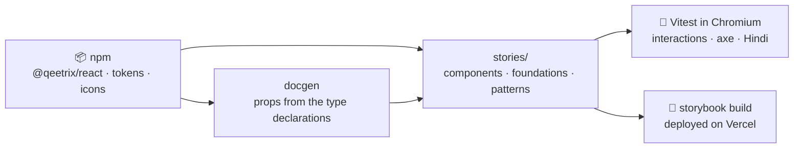

<div align="center">

# 📕 Qeetrix Storybook

**The workshop of Qeetrix, the Qeet Group design system: every `@qeetrix/react` component and every token, rendered
exactly as a Qeet product sees it.**

[](https://storybook.js.org)
[](package.json)
[](package.json)
[](docs/testing.md)

[🌐 ui.qeet.in](https://ui.qeet.in) · [🛠️ Develop](#-develop) · [📚 Contents](#-whats-inside) · [🤝 Contributing](CONTRIBUTING.md) · [📝 Changelog](CHANGELOG.md)

</div>

## 📦 What's inside

| | |
|:--|:--|
| 👋 **Welcome** | What Qeetrix is, the install line, where to start, and what's new |
| 📖 **Guides** | Getting started, and theming: colour scheme, density, language, right to left, a tenant's brand |
| 🎨 **Foundations** | Colour, typography, spacing, elevation, motion, iconography and brand, generated from the live tokens |
| 🧩 **Components** | An overview, then a page per component, stable or experimental: the import, a live example with every prop as a control, and focused examples |
| 🧱 **Patterns** | Qeet ID console screens built only from the library: sign-in, account settings, the dashboard header, the users table toolbar, search |

The toolbar sets what a product sets: **Theme** (`data-qx-color-scheme`), **Density** (`data-qx-density`),
**Language** (English or हिन्दी, through `QeetrixProvider`) and **Direction** (`<html dir>`).

## 🔗 How it fits

The workshop renders the **published packages** `bun.lock` installs, not a source checkout: what you see here is what
ships. Upgrading `@qeetrix/react` is a change to `package.json` like any other, and the tests prove every story still
renders, passes its interactions and passes axe on the new release.



## 🛠️ Develop

```sh
bun install
bun run dev        # the workshop on http://localhost:6006
bun run test       # every story as a test in headless Chromium, axe included
bun run build      # the static build, in storybook-static/
```

Each first runs `bun run docgen`, which reads every component's props and descriptions from `@qeetrix/react`'s type
declarations into `.storybook/docgen.json` (generated, not committed): the published JavaScript carries no types for
Storybook's own docgen. Interaction tests and the Hindi checks are stories too, tagged `!dev` and `!autodocs` so they
stay out of the sidebar and still run in every `bun run test`. Before every push, run the whole gate:
[CONTRIBUTING.md](CONTRIBUTING.md), "Before you push".

## 🚢 Releases

Work lands on `develop`. A pull request from `develop` into `main` with the version raised in `package.json` deploys
it: merging builds the workshop, deploys it to Vercel production and tags `vX.Y.Z`. `rollback.yml` redeploys an
earlier tag; tags up to v0.0.11 still rebuild against the `@qeetrix/ui` release they shipped with.

## 📚 Learn more

| | |
|:--|:--|
| 🤝 [Contributing](CONTRIBUTING.md) | Adding a story, the story contract, before you push |
| 🏗️ [Architecture](docs/architecture.md) · 🧪 [Testing](docs/testing.md) | How the workshop is built, and every gate |
| ♿ [Accessibility](docs/accessibility.md) · 📐 [Governance](docs/governance.md) | The axe gate, and the rules every page follows |
